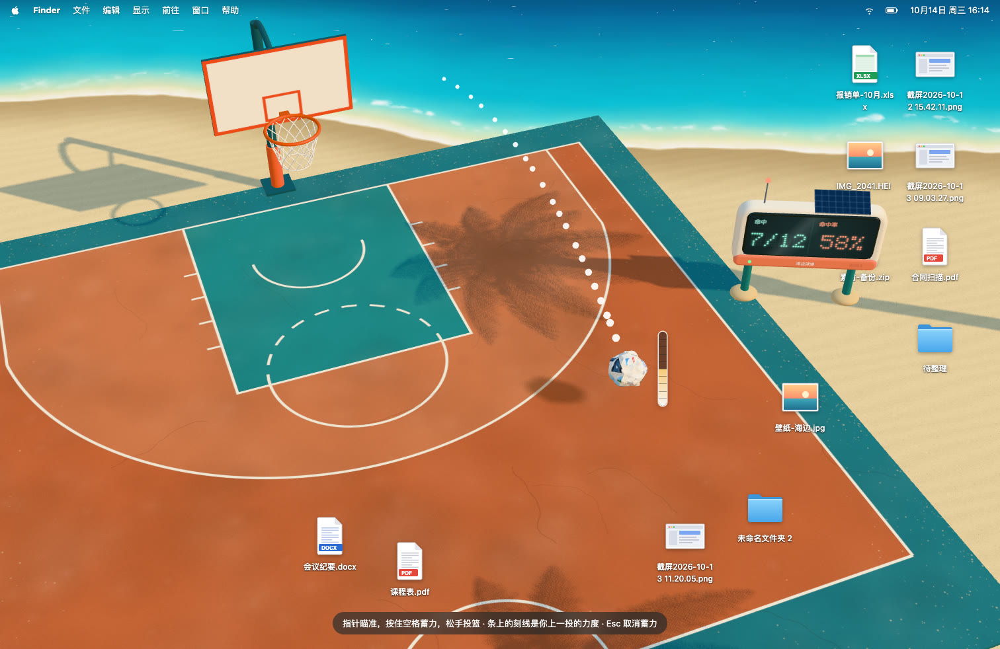
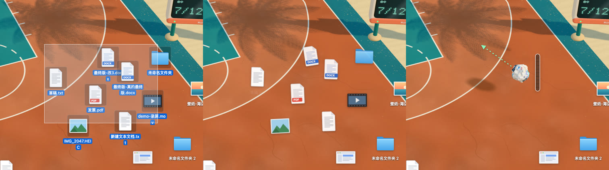
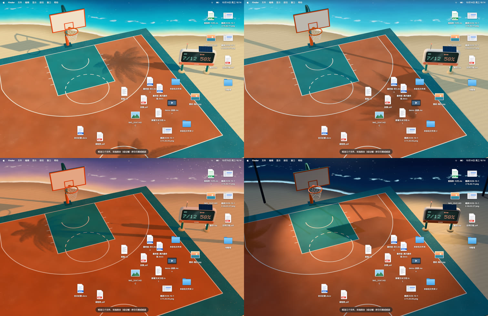

# 投篮吧 · 海边球场

把 Mac 桌面变成一块海边篮球场。框选桌面上乱糟糟的文件，揉成一个纸团，瞄准、蓄力，投进篮筐，文件就收进了「篮筐」文件夹。投丢了或者后悔了，按 ⌃⌥Z 放回原位。



## 怎么玩



1. 在桌面上框选几个文件，按 **⌃⌥X**（或者在触控板上双指捏合），它们会被揉成一个纸团，浮到你手上
2. **移动指针瞄准**，不用按住；箭头变绿表示对准了篮筐
3. **按住空格蓄力**：纸团上长出一条虚线弧线，蓄力越多弧线越长越高；力度条会来回涨落，条上的刻线是你上一投松手的位置（进了是绿色）
4. **松开空格**，投篮

命中不是白给的：正确的力度要自己找，松手早了晚了都会偏，擦框的球可能弹进也可能弹出。

| 操作 | 作用 |
|---|---|
| ⌃⌥X | 把桌面上选中的文件揉成纸团 |
| 双指捏合 | 同上（需要「输入监控」权限） |
| 移动指针 | 瞄准 |
| 按住 / 松开空格 | 蓄力 / 投篮 |
| ← / → | 微调方向 |
| Esc | 蓄力时取消这次蓄力；否则把纸团放下 |
| 拖动纸团 | 换个位置再投 |
| 双击纸团 | 拆开，文件回到原来的位置 |
| ⌃⌥Z | 撤销上一个纸团：还在场上就拆开，投进了就从篮筐放回原位；连按继续往前撤 |
| 点篮板 | 打开「文稿/篮筐」 |
| 点记分牌 | 打开菜单：时段、放回、记分牌清零、退出等 |

只有纸团在手上的时候空格才归球场，其余时候空格照常是访达的快速查看。

## 记分牌和时段



- **记分牌**立在球场右边的沙滩上：命中 a/b 和命中率，重启后保留。
- **时段**：默认跟随电脑时钟（5–9 点早晨，9–17 点正午，17–19:30 黄昏，其余夜晚），也可以在菜单里固定为正午、早晨、黄昏或夜晚。夜里会亮起两盏球场灯，海浪会泛蓝光。

## 文件安全

**不会删除任何文件。**

- 揉成纸团时：文件暂存到桌面上的隐藏文件夹 `~/Desktop/.beach-court/`
- 投进了：移到 `~/Documents/篮筐/<日期>/`，同时记下原来的图标位置（`~/Library/Application Support/BeachCourt/shots.json`），⌃⌥Z 靠它放回原处
- 双击拆开，或者退出 App：回到桌面原来的位置
- App 意外退出：下次启动时自动把暂存的文件放回桌面

## 安装

需要 macOS 14 以上、Apple 芯片的 Mac，以及 Xcode 命令行工具（`swiftc`）。

```bash
git clone https://github.com/Sin10874/toulanba.git
cd toulanba
./mac/build.sh
open "mac/build/海边球场.app"
```

- **签名**：`build.sh` 会优先用钥匙串里的 Apple Development 证书签名，这样重新编译后系统授权不会丢；第一次签名时钥匙串会弹窗，点「始终允许」。没有证书就用临时签名。
- **授权**：第一次揉纸团时 macOS 会请求「控制访达」（读取选中的文件和位置）和「访问桌面文件夹」（搬文件），都要允许。双指捏合还需要「输入监控」。
- **菜单**：点记分牌。菜单栏里也有一个 🏀 图标，但状态栏图标多的时候它可能被刘海挡住。
- **桌面排列**：放回原位依赖访达记录的图标位置，桌面需要是自由排列（显示 → 排序方式：无）。
- 目前只支持主显示器。

## 先在浏览器里试试

不装 App 也能玩，里面带一个模拟桌面：

```bash
cd web
python3 -m http.server 8893
```

打开 http://localhost:8893 ：框选图标，右键「揉成纸团」或者触控板捏合，然后瞄准、按住空格投篮。点记分牌可以轮换时段，也可以直接加参数 `?time=morning`、`?time=dusk`、`?time=night`。

## 代码结构

- `web/js/scene.js`：沙滩、海、球场、棕榈树、篮筐（全部用代码生成，没有外部美术素材）
- `web/js/ball.js`：纸团、投篮和篮筐物理
- `web/js/aim.js`：瞄准、蓄力、弧线
- `web/js/scoreboard.js`：记分牌
- `web/js/times.js`：时段
- `web/js/desktop.js`：浏览器原型里的模拟桌面
- `web/js/main.js`：组装；`?layer=back` 和 `?layer=front` 是 App 的两层窗口
- `mac/BeachCourt.swift`：Mac App。球场窗口在访达图标层的下面一层，篮筐和纸团在上面一层；只有纸团、篮板和记分牌接收点击。负责读取访达选中项、搬文件、全局快捷键和菜单。

开发时 App 直接读取项目里的 `web/`，文件一改就自动刷新，只有改 Swift 才需要重新编译。日志在 `~/Library/Logs/BeachCourt.log`。

## 致谢

- [three.js](https://threejs.org)（MIT），放在 `web/vendor/three`
- 灵感来自一个「给桌面铺块地毯，把杂物扫到地毯下面」的创意视频
